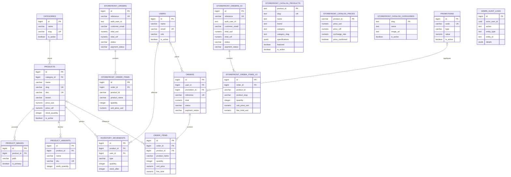

# Modèle de données — CTRL-TECH

> **Instantané du schéma réel** de la base Neon `ctrltech`, relevé le 12 novembre 2026 sur la branche de déploiement `br-weathered-truth-bayel0tz`. Ce document décrit la structure observée, pas un modèle cible inventé.

## 1. Vue d'ensemble

La base contient deux ensembles métier historiques et actuels :

- **`storefront`** : schéma actuellement utilisé par la boutique et son administration (catalogue, prix, commandes et journal d'audit).
- **`public`** : tables d'une ancienne structure e-commerce (produits, catégories, clients, promotions, commandes, stock), toujours présentes dans la base.

Neon Auth possède également ses propres tables dans `neon_auth`. Elles sont administrées par le service d'authentification et ne font pas partie du SQL de reconstruction métier fourni ici.

## 2. Vue relationnelle type Merise (ERD)

La représentation ci-dessous montre les entités et les associations. Les relations dessinées entre les tables `public` et `storefront` correspondent aux clés étrangères effectivement déclarées. Les liens purement applicatifs sont expliqués après le diagramme.

## 3. Associations et cardinalités (lecture MCD)

| Association | Cardinalité | Règle |
|---|---|---|
| CATEGORIE — PRODUIT (ancien modèle) | 1,N | Un produit peut être rattaché à une catégorie ; une catégorie regroupe plusieurs produits. |
| PRODUIT — IMAGE | 1,N | Une image appartient à un seul produit. |
| PRODUIT — VARIANTE | 1,N | Un produit peut avoir plusieurs variantes. |
| PRODUIT — MOUVEMENT_STOCK | 1,N | Un mouvement concerne un produit. |
| UTILISATEUR — COMMANDE (ancien modèle) | 0,N | Une commande peut rester sans utilisateur associé. |
| COMMANDE — LIGNE_COMMANDE | 1,N | Une commande contient ses lignes. |
| PRODUIT — LIGNE_COMMANDE | 0,N | Une ligne conserve aussi le nom et le prix au moment de la commande. |
| PROMOTION — COMMANDE | 0,N | Une commande peut appliquer une promotion. |
| COMMANDE_BOUTIQUE — LIGNE_BOUTIQUE | 1,N | Une commande de la boutique possède ses lignes. |

## 4. Liens logiques non matérialisés par une clé étrangère

Ces colonnes se correspondent dans le fonctionnement applicatif, mais PostgreSQL ne déclare pas de contrainte FK entre elles :

- `storefront.catalog_prices.product_id` → `storefront.catalog_products.product_id` (prix du produit ; relation 1–1 attendue).
- `storefront.catalog_products.category_slug` → `storefront.catalog_categories.slug` (catégorie du produit).
- `storefront.order_items.product_id` → `storefront.catalog_products.product_id` (référence produit conservée dans la ligne).
- `storefront.orders.auth_user_id` → `neon_auth.user.id` (identité du client gérée par Neon Auth).
- `storefront.admin_audit_logs.actor_user_id` → `neon_auth.user.id` (administrateur auteur de l'action).
- Les tables `public.storefront_orders` / `public.storefront_order_items` représentent un autre ensemble historique, distinct des tables du schéma `storefront`.

## 5. Entités principales et attributs

### Ancien modèle — schéma `public`

| Entité | Attributs importants | Clés |
|---|---|---|
| `users` | name, email, role, phone, address, is_active | PK id ; UQ email |
| `categories` | name, slug, description, sort_order, is_active | PK id ; UQ slug |
| `brands` | name, slug, description, is_active | PK id ; UQ slug |
| `products` | category_id, name, slug, sku, brand, prices, stock_quantity, specifications | PK id ; FK category_id ; UQ slug/sku |
| `product_images` | product_id, path, alt, is_primary, sort_order | PK id ; FK product_id |
| `product_variants` | product_id, name, sku, options, price_delta, stock_quantity | PK id ; FK product_id |
| `inventory_movements` | product_id, user_id, type, quantity, stock_after, reason | PK id ; FK product_id/user_id |
| `promotions` | code, type, value, minimum_order, dates, usage_limit | PK id ; UQ code |
| `orders` | user_id, promotion_id, reference, customer, delivery, totals, status | PK id ; FK user_id/promotion_id ; UQ reference |
| `order_items` | order_id, product_id, product_name, quantity, unit_price, line_total | PK id ; FK order_id/product_id |
| `sessions` | id, user_id, ip_address, payload, last_activity | PK id |
| `password_reset_tokens` | email, token, created_at | PK email |

### Modèle de la boutique déployée — schéma `storefront`

| Entité | Attributs importants | Clés |
|---|---|---|
| `catalog_products` | product_id, slug, name, brand, category, category_slug, image_url, specifications, featured, is_active | PK product_id ; UQ slug |
| `catalog_prices` | product_id, price_usd, price_cdf, exchange_rate, price_confirmed | PK product_id |
| `catalog_categories` | slug, name, description, image_url, sort_order, is_active | PK slug |
| `orders` | reference, auth_user_id, customer, delivery, totals USD/CDF, status, payment_status | PK id ; UQ reference |
| `order_items` | order_id, product_id, product_slug, product_name, brand, quantity, unit_price_usd, line_total_usd | PK id ; FK order_id |
| `admin_audit_logs` | actor_user_id, action, entity_type, entity_id, details, created_at | PK id |

## 6. Fichier SQL

Le fichier `../database/schema-ctrl-tech.sql` contient les instructions `CREATE SCHEMA`, `CREATE SEQUENCE`, `CREATE TABLE`, contraintes et index non uniques extraits de la structure Neon. Il ne contient aucune donnée client, aucun mot de passe et aucune insertion de catalogue.

## 7. Limites et précautions

- Le fichier SQL est un **instantané de structure**, pas une sauvegarde complète de la base.
- Les tables internes `neon_auth.*`, le registre `public.migrations`, les rôles, les permissions et les données ne sont pas recréés.
- Les colonnes représentant des liens logiques sans FK sont documentées, mais aucune contrainte nouvelle n'est ajoutée.
- Les deux familles de tables de commandes sont conservées dans le document : elles ne doivent pas être fusionnées sans migration dédiée.
